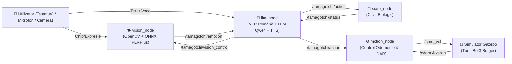

# 🤖 Proiect Sincretic: Robot Tamagotchi (ROS 2 Jazzy & Gazebo Harmonic)

Un robot mobil autonom de tip **Tamagotchi** construit în **ROS 2 Jazzy** pentru simulatorul 3D **Gazebo Harmonic** (TurtleBot3 Burger), care combină:
- **Simularea unui ciclu biologic complet** (Hrană, Energie, Fericire, Sănătate, Somn/Treaz);
- **Controlul mișcărilor de înaltă precizie** în buclă închisă pe baza Odometriei (`/odom`) și navigația autonomă cu senzorul **LiDAR (`/scan`)**;
- **Inteligență Artificială conversațională în limba română** prin **LLM local (`llama.cpp` / Qwen2.5-1.5B-Instruct)**;
- **Control Vocal (Speech-to-Text)** și **Sinteză Vocală (Text-to-Speech)** în limba română;
- **Viziune Artificială & Recunoașterea Emoțiilor Faciale** în timp real folosind **OpenCV + ONNX Deep Learning (`Emotion-FERPlus`)**, conectată direct la reacțiile fizice ale robotului.

---

## 🏗️ Arhitectura Sistemului (Noduri și Topicuri ROS 2)

Proiectul este organizat modular în 5 noduri ROS 2 independente care comunică prin topicuri dedicate:

| Nod ROS 2 | Fișier Sursă | Rol și Funcționalitate |
| :--- | :--- | :--- |
| **`tamagotchi_state`** | [`tamagotchi_robot/state_node.py`](tamagotchi_robot/state_node.py) | Simulează metabolismul și starea biologică a robotului (`hrană`, `energie`, `fericire`, `sănătate`, `stare: treaz/doarme`). Publică starea pe `/tamagotchi/status` și actualizează parametrii la fiecare acțiune primită pe `/tamagotchi/action`. |
| **`tamagotchi_motion`** | [`tamagotchi_robot/motion_node.py`](tamagotchi_robot/motion_node.py) | Traduce acțiunile în comenzi fizice de viteză (`TwistStamped` pe `/cmd_vel`). Include rotații de precizie ($N \times 360^\circ$) și viraje ($90^\circ$) pe baza `/odom`, protecție anti-coliziune și **Turul Arenei** autonom (Right-Wall Following) folosind LiDAR-ul (`/scan`). |
| **`tamagotchi_llm`** | [`tamagotchi_robot/llm_node.py`](tamagotchi_robot/llm_node.py) | Interfața centrală cu meniu interactiv, procesarea limbajului natural în limba română, integrarea cu serverul local `llama-server` (port `8080`), înregistrare vocală (`arecord` + Google STT) și răspuns vocal (`spd-say`). |
| **`tamagotchi_vision`** | [`tamagotchi_robot/vision_node.py`](tamagotchi_robot/vision_node.py) | Modulul de viziune artificială controlabil la cerere (`/tamagotchi/vision_control`). Detectează fața utilizatorului și clasifică emoția (`FERICIT`, `TRIST`, `NEUTRU`) folosind rețeaua neuronală [`models/emotion-ferplus-8.onnx`](models/emotion-ferplus-8.onnx), declanșând automat dansul sau pirueta robotului. |
| **`tamagotchi_voice`** | [`tamagotchi_robot/voice_node.py`](tamagotchi_robot/voice_node.py) | Nod opțional dedicat exclusiv consolei vocale externe (publică textul transcris pe `/tamagotchi/user_input`). |

### Diagrama de Comunicație ROS 2



---

## 📋 Meniu Comenzi Simplificate (Tastatură, Scurtături & Voce)

În consola interactivă `llm_node`, robotul poate fi controlat prin **scurtături numerice (`0`–`14`)**, **cuvinte cheie scurte**, **propoziții libere în limba română** sau **vocal (`v`)**:

### 🕹️ 1. Mișcare & Navigație în Simulator
| Scurtătură | Comandă Simplificată | Exemple în Limbaj Natural / Vocal | Acțiune Fizică a Robotului |
| :---: | :--- | :--- | :--- |
| **`1`** | `fata` | *"Mergi în față"*, *"Avansează"* | Deplasare înainte `0.8m` cu protecție anti-coliziune LiDAR (`<28cm`). |
| **`2`** | `spate` | *"Mergi în spate"*, *"Dă-te înapoi"* | Deplasare înapoi `0.8m` cu protecție LiDAR. |
| **`3`** | `fata spate` | *"Mergi înainte și înapoi"* | Plimbare jucăușă față-spate. |
| **`4`** | `stanga` | *"Virează la stânga"* | Viraj precis de `90°` la stânga pe baza odometriei (`/odom`). |
| **`5`** | `dreapta` | *"Virează la dreapta"* | Viraj precis de `90°` la dreapta pe baza odometriei (`/odom`). |
| **`6`** | `invarte` | *"Fă o rotație"*, *"Fă o piruetă"* | Rotație completă de `360°` în buclă închisă. |
| **`7`** | `invarte 5` | *"Învârte-te de 10 ori"*, *"Fă 3 rotații"* | Efectuează exact $N$ rotații complete ($N \times 360^\circ$). |
| **`8`** | `tur` | *"Fă turul arenei"*, *"Urmează peretele"* | Navigație autonomă cu LiDAR: localizează cel mai apropiat perete, se aliniază și urmărește conturul arenei. |
| **`0`** | `stop` | *"Stop!"*, *"Oprește-te!"*, *"Stai!"* | Oprire de urgență imediată a motoarelor. |

### 🐶 2. Nevoi Biologice Tamagotchi
| Scurtătură | Comandă Simplificată | Efect Biologic & Comportament |
| :---: | :--- | :--- |
| **`9`** | `mananca` | `+25% Hrană`, `+10% Fericire` + mișcare de bucurie pentru mâncare. |
| **`10`** | `joaca` | `+25% Fericire`, `-10% Energie`, `-5% Hrană` + dansul bucuriei. |
| **`11`** | `dormi` | Intră în modul somn (`doarme`), oprește motoarele și regenerează `+6% Energie` / `+2% Sănătate` la fiecare 3s. |
| **`12`** | `trezirea` | Trezește robotul (`treaz`) și execută mișcarea de întindere. |
| **`13`** | `doctor` | `+35% Sănătate` + mișcare de recunoștință. |
| **`14`** | `stare` | Raportează procentele curente de Hrană, Energie, Sănătate și Fericire. |

### 📷 3. Cameră AI (Recunoaștere Facială) & Voce
| Scurtătură | Comandă Simplificată | Funcționalitate |
| :---: | :--- | :--- |
| **`c`** | `porneste camera` / `opreste camera` | Deschide sau închide fereastra video AI. Când camera este pornită: <br>• **Zâmbet (`FERICIT`)** $\rightarrow$ Robotul dansează (`PLAY`)!<br>• **Tristețe (`TRIST`)** $\rightarrow$ Robotul face o piruetă (`ROTATE:1`) ca să te înveselească! |
| **`v`** | `voce` | Înregistrează comanda ta vocală timp de 4 secunde și o execută. |
| **`m`** | `meniu` | Afișează meniul complet de comenzi în terminal. |

---

## 🚀 Instalare și Pornire Rapidă

### 1. Cerințe de Sistem
- **Ubuntu 24.04 LTS** cu **ROS 2 Jazzy Jalisco** și **Gazebo Harmonic** (`ros-jazzy-turtlebot3-gazebo`)
- **Python 3.12+**, `opencv-python`, `numpy`, `SpeechRecognition`, `alsa-utils` (`arecord`), `speech-dispatcher` (`spd-say`)
- Opțional pentru conversații libere AI: `llama.cpp` compilat în `~/llama.cpp` cu modelul `qwen2.5-coder-1.5b-instruct-q4_k_m.gguf`

### 2. Compilarea Pachetului ROS 2
```bash
mkdir -p ~/ros2_ws/src
cd ~/ros2_ws/src
# Clonează acest repository în ~/ros2_ws/src/tamagotchi_robot
cd ~/ros2_ws
source /opt/ros/jazzy/setup.bash
colcon build --symlink-install
source ~/ros2_ws/install/setup.bash
```

### 3. Pornirea Proiectului Complet
Poți porni întregul sistem folosind scriptul rapid inclus [`start_tamagotchi.sh`](start_tamagotchi.sh):
```bash
bash ~/ros2_ws/src/tamagotchi_robot/start_tamagotchi.sh
```
Sau manual, în 3 terminale:

**Terminal 1 — Simulatorul 3D Gazebo (TurtleBot3 World):**
```bash
source /opt/ros/jazzy/setup.bash
export ROS_DOMAIN_ID=99 TURTLEBOT3_MODEL=burger GZ_VERSION=harmonic
ros2 launch turtlebot3_gazebo turtlebot3_world.launch.py
```

**Terminal 2 — Nodurile de Stare, Mișcare și Viziune AI:**
```bash
source /opt/ros/jazzy/setup.bash
source ~/ros2_ws/install/setup.bash
export ROS_DOMAIN_ID=99 TURTLEBOT3_MODEL=burger GZ_VERSION=harmonic
ros2 launch tamagotchi_robot tamagotchi.launch.py
```

**Terminal 3 — Consola Interactivă LLM, Meniu & Voce:**
```bash
source /opt/ros/jazzy/setup.bash
source ~/ros2_ws/install/setup.bash
export ROS_DOMAIN_ID=99 TURTLEBOT3_MODEL=burger GZ_VERSION=harmonic
ros2 run tamagotchi_robot llm_node
```

---

## 📁 Structura Fișierelor din Proiect

```text
tamagotchi_robot/
├── README.md                          # Documentația completă a proiectului
├── package.xml                        # Manifestul pachetului ROS 2
├── setup.py                           # Configurația de instalare Python / ROS 2
├── setup.cfg                          # Configurația entry-point-urilor ROS 2
├── start_tamagotchi.sh                # Script de pornire automată a întregului proiect
├── launch/
│   └── tamagotchi.launch.py           # Launch file pentru state_node, motion_node și vision_node
├── models/
│   └── emotion-ferplus-8.onnx         # Rețea neuronală profundă ONNX pentru expresii faciale
├── scripts/
│   └── setup_ros2_jazzy.sh            # Scriptul de instalare și configurare ROS 2 Jazzy + TurtleBot3
└── tamagotchi_robot/
    ├── __init__.py
    ├── state_node.py                  # Ciclul biologic Tamagotchi
    ├── motion_node.py                 # Controlul mișcărilor (Odometrie + LiDAR Wall Following)
    ├── llm_node.py                    # Consola interactivă, NLP română, LLM, TTS & STT
    ├── vision_node.py                 # Detecția feței și clasificarea emoțiilor (OpenCV + ONNX)
    └── voice_node.py                  # Nod dedicat pentru comenzi vocale
```
